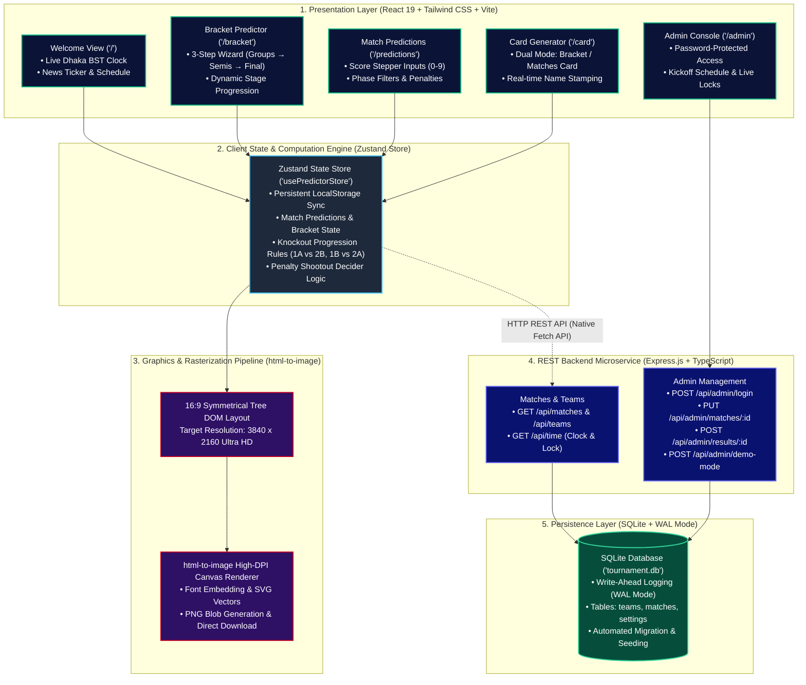

# SAFF Championship Bangladesh 2026 — Tournament Predictor

[](https://react.dev/)
[](https://www.typescriptlang.org/)
[](https://vitejs.dev/)
[](https://tailwindcss.com/)
[](https://expressjs.com/)
[](https://www.sqlite.org/)
[](https://github.com/pmndrs/zustand)
[](https://opensource.org/licenses/MIT)

> **SAFF 2026 Predictor** is a production-grade, full-stack tournament simulation and fan engagement platform engineered for the **SAFF Championship Bangladesh 2026** (5 – 17 November 2026, National Stadium, Dhaka). It pairs interactive 3D bracket path progression with match-by-match score forecasting, real-time penalty shootout resolution, authenticated administrative tournament controls, and client-side **16:9 Ultra HD (3840 × 2160)** shareable card rasterization.

---

## Table of Contents
1. [Project Overview & Problem Statement](#project-overview--problem-statement)
2. [System Architecture & Data Flow](#system-architecture--data-flow)
3. [Core Tournament Engines](#core-tournament-engines)
4. [Frontend Application & Interactive Views](#frontend-application--interactive-views)
5. [Authenticated Admin Operations](#authenticated-admin-operations)
6. [Full-Stack API Reference](#full-stack-api-reference)
7. [Official Tournament Fixtures & Schedule](#official-tournament-fixtures--schedule)
8. [Quick Start & Installation](#quick-start--installation)
9. [Production Build & Preview](#production-build--preview)
10. [Environment Variables Reference](#environment-variables-reference)
11. [Project Directory Structure](#project-directory-structure)
12. [License & Disclaimer](#license--disclaimer)

---

## Project Overview & Problem Statement

### The Real-World Dilemma
The South Asian Football Federation (SAFF) Championship represents a region of nearly **2 billion people** across 7 member nations (Bangladesh, India, Maldives, Nepal, Pakistan, Bhutan, and Sri Lanka). Despite massive regional football passion, tournament fan engagement faces significant digital hurdles:
- **Fragmented Prediction Methods**: Regional fan contests traditionally rely on static Google Forms, social media comments, or PDF sheets that lack live standings and tiebreaker computation.
- **Score vs. Bracket Disconnect**: Fans cannot easily simulate high-level knockout pathways alongside granular match-by-match scorelines without manual recalculation.
- **Social Sharing Friction**: Most existing fan tools produce cropped mobile screenshots or low-res graphics that distort when shared on social platforms.
- **Manual Administration Overhead**: Community contest organizers face slow, manual score entry, tedious tiebreaker resolution, and a lack of automated kickoff locks.

### The SAFF 2026 Solution
SAFF 2026 Predictor addresses these challenges through a unified full-stack architecture:
1. **Granular Match Score Forecasts**: Interactive 0–9 score stepper controls for all 9 tournament fixtures (M01 to M09), complete with phase filtering (All / Group / Knockout) and live completion tracking (`X / 9 Predicted`).
2. **Stage-Gated 3D Stadium Path**: An intuitive 3-step bracket workflow (Group Qualifiers → Semi-Finals → Champion) with interactive match cards and dynamic advancement unlocks.
3. **Penalty Shootout Decider**: Automated tie detection for knockout fixtures with interactive penalty shootouts and distinct `(P)` winner badges.
4. **Dual 16:9 Ultra HD Card Rasterization**: High-resolution client-side canvas generation rendering 3840 × 2160 PNG prediction cards with real-time name stamping (`PREDICTED BY <NAME>`).
5. **Secure Administrative Command Center**: Password-protected dashboard enabling real-time kickoff timestamps, official score entry, match locking, and instant switching between Demo and Live modes.

---

## System Architecture & Data Flow



---

## Core Tournament Engines

### 1. Granular Match Score Prediction Engine
Users can forecast exact scorelines for every tournament fixture:
- **0–9 Stepper Controls**: Rapid one-click increment and decrement controls for both home and away scores.
- **Phase Filtering**: Seamlessly filter fixtures between Group Stage (M01–M06) and Knockouts (M07–M09).
- **Completion Telemetry**: Dynamic live progress tracker calculating prediction completion percentage (`X / 9 Done`).
- **One-Click Quick Actions**: Quick "Set 0–0" baseline or "Clear" buttons per fixture.

### 2. Stage-Gated Knockout Progression
Knockout fixtures dynamically unlock as prior stages are completed:
- **Group Stage:** 6 fixtures across Group A (BAN, BHU, SRI) and Group B (IND, MDV, PAK).
- **Semi-Final 2 (M08):** Automatically pairs **Winner Group A (1A)** vs **Runner-Up Group B (2B)**.
- **Semi-Final 1 (M07):** Automatically pairs **Winner Group B (1B)** vs **Runner-Up Group A (2A)**.
- **Grand Final (M09):** Automatically pairs the victorious nations from M08 and M07 to crown the Champion.

### 3. Penalty Shootout Decider
If a knockout fixture ends level after 90 minutes (e.g., 1–1 or 2–2), the interface reveals an interactive **Penalty Decider** toggle. The selected penalty winner is flagged with a distinctive `(P)` badge and promoted to the subsequent round.

### 4. Client-Side Ultra HD Rasterization Engine
Utilizing `html-to-image`, the platform constructs a pristine 16:9 widescreen canvas:
- **Target Resolution:** 3840 × 2160 pixels (Ultra HD 4K).
- **Pixel Density:** Scaled canvas rendering ensuring zero blurriness, font artifacts, or connector displacement.
- **Branding Protection:** Automatically watermarked with official tournament emblems and user personalization (`PREDICTED BY <NAME>`).

---

## Frontend Application & Interactive Views

| View | Route | Primary Capabilities | Responsive Design Highlights |
|---|---|---|---|
| **Welcome** | `/` | Dhaka BST countdown timer, tournament calendar, official news feed, and quick-start action pills. | Fluid typography, hero emblem container, single emerald live indicator. |
| **Bracket Predictor** | `/bracket` | 3-step progressive wizard (Groups → Semi-Finals → Champion) with stage indicator and summary review. | Full-width mobile stadium cards, sticky action capsule, desktop 3D stadium layout. |
| **Match Predictions** | `/predictions` | Fixture-by-fixture score steppers (0–9), live summary progress rail, penalty deciders, and clear buttons. | Desktop sticky 2-column summary rail; mobile floating action bottom bar. |
| **Card Generator** | `/card` | Dual-mode exporter (Bracket Card vs Matches Card), live name input, 16:9 canvas preview, and Ultra HD download. | Scaled CSS viewport transform preserving exact 16:9 aspect ratio across all screen sizes. |
| **Admin Console** | `/admin` | Password-protected console for managing fixtures, official results, kickoff dates, and Demo/Live modes. | Collapsible fixture cards, status badges, and real-time database write confirmations. |

---

## Authenticated Admin Operations

The administrative command center (`/admin`) provides tournament officials with full operational control:

- **Authentication:** Password protected via server environment variable (`ADMIN_PASSWORD`).
- **Fixture Configuration:** Update venue details and kickoff timestamps in Dhaka Bangladesh Standard Time (BST, UTC+6).
- **Official Score Entry:** Record final scores and penalty shootout winners for official tournament verification.
- **Match Locking:** Manually or automatically lock fixtures once kickoff commences to prevent retroactive user predictions.
- **Demo Mode vs. Live Mode:**
  - **Demo Mode:** Bypasses kickoff timestamp locks so evaluators and fans can freely test all predictions.
  - **Live Mode:** Enforces strict real-time kickoff locking based on the system clock.

---

## Full-Stack API Reference

| Method | Endpoint | Access | Description | Request Body |
|---|---|---|---|---|
| `GET` | `/api/time` | Public | Returns server clock, bracket lock timestamp, and Demo Mode status | *None* |
| `GET` | `/api/teams` | Public | Returns list of participating nations, flags, and group assignments | *None* |
| `GET` | `/api/matches` | Public | Returns all 9 tournament fixtures with joined team metadata and lock status | *None* |
| `POST` | `/api/admin/login` | Public | Validates admin password and grants authenticated session token | `{"password": "admin-password"}` |
| `PUT` | `/api/admin/matches/:id` | Admin | Updates match kickoff timestamp, venue, or match status | `{"kickoff": "2026-11-05T16:30:00+06:00"}` |
| `POST` | `/api/admin/results/:id` | Admin | Records official scores and penalty shootout outcomes | `{"homeScore": 2, "awayScore": 1, "penaltyWinner": null}` |
| `POST` | `/api/admin/demo-mode` | Admin | Toggles between Demo Mode (unlocked) and Live Mode (clock locked) | `{"demoMode": true}` |
| `POST` | `/api/admin/reset-scores` | Admin | Resets all official match scores and penalties back to unplayed | *None* |

---

## Official Tournament Fixtures & Schedule

All fixtures take place at the **National Stadium, Dhaka, Bangladesh** (Dhaka BST, UTC+6).

| Match | Stage | Date | Time (BST) | Home Team | Away Team | Venue |
|:---:|---|:---:|:---:|:---:|:---:|---|
| **M01** | Group B | 05 Nov 2026 | 15:30 | **Pakistan** 🇵🇰 | **India** 🇮🇳 | National Stadium, Dhaka |
| **M02** | Group A | 05 Nov 2026 | 20:00 | **Bhutan** 🇧🇹 | **Bangladesh** 🇧🇩 | National Stadium, Dhaka |
| **M03** | Group B | 08 Nov 2026 | 15:30 | **Maldives** 🇲🇻 | **Pakistan** 🇵🇰 | National Stadium, Dhaka |
| **M04** | Group A | 08 Nov 2026 | 20:00 | **Sri Lanka** 🇱🇰 | **Bhutan** 🇧🇹 | National Stadium, Dhaka |
| **M05** | Group B | 11 Nov 2026 | 15:30 | **India** 🇮🇳 | **Maldives** 🇲🇻 | National Stadium, Dhaka |
| **M06** | Group A | 11 Nov 2026 | 20:00 | **Bangladesh** 🇧🇩 | **Sri Lanka** 🇱🇰 | National Stadium, Dhaka |
| **M07** | Semi-Final 1 | 14 Nov 2026 | 15:00 | **Winner Group B (1B)** | **Runner-Up Group A (2A)** | National Stadium, Dhaka |
| **M08** | Semi-Final 2 | 14 Nov 2026 | 20:30 | **Winner Group A (1A)** | **Runner-Up Group B (2B)** | National Stadium, Dhaka |
| **M09** | **Grand Final** | 17 Nov 2026 | 20:00 | **Winner SF1** | **Winner SF2** | National Stadium, Dhaka |

---

## Quick Start & Installation

### 1. Prerequisites
- **Node.js**: v18.0.0 or higher
- **npm**: v9.0.0 or higher
- **Git**: Installed and configured

### 2. Clone Repository & Install Dependencies
```bash
git clone https://github.com/SafayetHossain-783/SAFF-2026-Predictor.git
cd SAFF-2026-Predictor
npm install
```

### 3. Launch Development Environment

#### Option A: Run Full-Stack Concurrently (Root)
```bash
npm run dev
```
- **Frontend Client:** [http://localhost:5173](http://localhost:5173)
- **Backend API Server:** [http://localhost:3001](http://localhost:3001)

#### Option B: Launch Services Individually
```bash
# 1. Launch Backend API Microservice
cd backend
npm run dev

# 2. In a separate terminal, launch Frontend Client SPA
cd frontend
npm run dev
```

---

## Production Build & Preview

### 1. Production Client Bundle
```bash
# From repository root
npm run build

# Or directly within frontend directory
cd frontend
npm run build
```
*Compiles optimized static assets into `frontend/dist/`.*

### 2. Production Preview
```bash
npm run preview
```
*Serves the production bundle locally on [http://localhost:4173](http://localhost:4173).*

---

## Environment Variables Reference

A `.env` file can optionally be created in the root directory (based on `.env.example`):

| Variable | Scope | Default Value | Description |
|---|---|---|---|
| `PORT` | Backend | `3001` | Express server port |
| `ADMIN_PASSWORD` | Backend | *(Configured via `.env`)* | Master authentication password for the admin console |

> **Note:** During local development, Vite reverse-proxies `/api` network calls to `http://localhost:3001` automatically without requiring client-side URL environment overrides.

---

## Project Directory Structure

```text
saff-2026-predictor/
├── frontend/                     # React 19 + Vite Single Page Application
│   ├── public/                   # Static production assets
│   │   ├── favicon.ico           # Multi-layer (16/32/48/64px) official SAFF icon
│   │   ├── favicon.png           # 64x64 square SAFF emblem
│   │   ├── favicon.svg           # Square vector wrapper
│   │   ├── icons.svg             # Vector sprite sheet
│   │   └── saff-transparent.png  # High-resolution tournament logo
│   ├── src/
│   │   ├── api/                  # Native Fetch REST API client bindings
│   │   │   └── client.ts
│   │   ├── components/           # Reusable UI components
│   │   │   ├── Flags.tsx         # Vector flags for all 7 South Asian nations
│   │   │   ├── Icons.tsx         # UI vector icons (no trophy icons)
│   │   │   └── TopBar.tsx        # Responsive navigation header
│   │   ├── pages/                # Primary route views
│   │   │   ├── AdminPage.tsx     # Password-gated admin management dashboard
│   │   │   ├── BracketPage.tsx   # 3-step progressive tournament bracket predictor
│   │   │   ├── CardPage.tsx      # 16:9 Ultra HD shareable card generator
│   │   │   ├── PredictionsPage.tsx # Match score predictions & progress engine
│   │   │   └── WelcomePage.tsx   # Landing page with countdown timer and news
│   │   ├── stores/               # Zustand global store with localStorage persistence
│   │   │   └── usePredictorStore.ts
│   │   ├── types/                # Domain TypeScript interfaces
│   │   │   └── index.ts
│   │   ├── branding.ts           # Central tournament branding constants
│   │   ├── index.css             # Global styles & Tailwind CSS utility layers
│   │   ├── App.tsx               # Main application container
│   │   └── main.tsx              # React DOM root entrypoint
│   ├── index.html                # HTML5 entry with official SAFF favicon
│   ├── package.json              # Frontend dependencies and build scripts
│   ├── postcss.config.js         # PostCSS configuration for Tailwind CSS
│   ├── tailwind.config.js        # Custom theme: Navy, Emerald, Crimson
│   ├── tsconfig.app.json         # Client TypeScript configuration
│   ├── tsconfig.json             # Root TypeScript configuration
│   ├── tsconfig.node.json        # Tooling TypeScript configuration
│   └── vite.config.ts            # Vite bundler & reverse proxy configuration
│
├── backend/                      # Express & SQLite REST Backend Microservice
│   ├── db.ts                     # SQLite schema setup, WAL pragma & auto-seeding
│   ├── index.ts                  # REST API endpoints & admin auth middleware
│   ├── tournament.db             # Active SQLite database file
│   ├── package.json              # Backend dependencies and tsx execution scripts
│   └── tsconfig.json             # NodeNext TypeScript configuration
│
├── .env.example                  # Environment configuration template
├── .gitignore                    # Production git exclusions
├── package.json                  # Root npm workspaces orchestrator
└── README.md                     # Comprehensive project documentation
```

---

## License & Disclaimer

Distributed under the **MIT License**. Official tournament emblems, team insignias, and tournament naming rights belong to the **South Asian Football Federation (SAFF)**.

